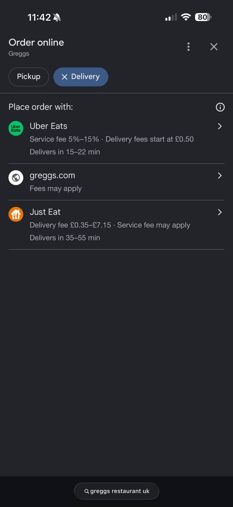
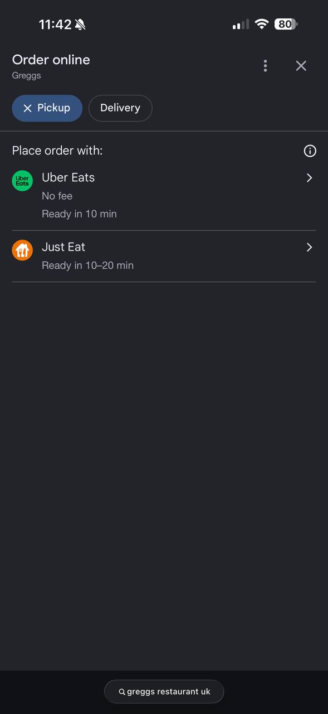

# Greggs mid-term note: my draft (in progress)

Written from my own answers; Claude fixed spelling and grammar only.

## Introduction

Greggs is a UK-based company that sells food, and it has around 2,700 branches (Greggs plc, 2026). Its profit went down by about 4% (Greggs plc, 2026), and the cost of hiring staff also went up (HM Treasury, 2024). The shops do not bake based on customer demand; they rely on their own guesses, which leads to leftover food. Using the information from everyday orders on the app, Greggs can predict what to bake in future, which will also help it plan how many staff it needs. I chose Greggs because I buy from it myself: there is a shop close to my university, and I find it reliable.

## 1. Value opportunities

**Economic:** People have less money, so they buy cheaper things. This means Greggs cannot simply raise its prices to cover higher staff costs (HM Treasury, 2024), because it would lose customers. Near my university, I could also buy cheap food at McDonald's or Subway. People might choose them because of their sandwiches. I still choose Greggs because it is reliable. This shows that customers can easily go somewhere else, so Greggs has to keep its prices low (Porter, 2008).

**Social:** When people order through the Greggs app, Greggs keeps more of the money. When they order through delivery apps like Uber Eats, part of the money goes to the app, so Greggs loses out (Greggs plc, 2026).

**Environmental:** Leftover food makes Greggs lose money, because that food could have been sold for a profit. Instead, it goes bad or is given away.

## Reference list (so far)

Curchod, C. (2026a) 'The challenges ahead: potential obstacles to transformation and how to overcome them' [Lecture slides], *The Strategy of Digital Transformation*. University of Edinburgh Business School. Available at: Learn (Accessed: 30 October 2026).

Greggs plc (2026) *Preliminary results for the 52 weeks ended 27 December 2025*. Newcastle upon Tyne: Greggs plc. Available at: https://assets.greggs.com/f/162306/x/e616871d6c/260303-greggs-2025-preliminary-results-final.pdf (Accessed: 30 October 2026).

HM Treasury (2024) *Autumn Budget 2024* (HC 295). London: HM Treasury. Available at: https://www.gov.uk/government/publications/autumn-budget-2024 (Accessed: 30 October 2026).

Leonard-Barton, D. (1992) 'Core capabilities and core rigidities: a paradox in managing new product development', *Strategic Management Journal*, 13(S1), pp. 111–125. doi: 10.1002/smj.4250131009.

Porter, M.E. (1996) 'What is strategy?', *Harvard Business Review*, 74(6), pp. 61–78.

Porter, M.E. (2008) 'The five competitive forces that shape strategy', *Harvard Business Review*, 86(1), pp. 78–93.

Whittington, R., Regnér, P., Angwin, D., Johnson, G. and Scholes, K. (2024) *Fundamentals of strategy*. 6th edn. Harlow: Pearson.

## 2. How the business model will change

Greggs gives customers cheap food in shops that are close by and reliable (value creation). However, each shop does not bake based on customer demand; it relies on its own guesses, which leads to leftover food (value configuration). Greggs makes money by selling lots of cheap items to lots of people (value capture) (Greggs plc, 2026).

When I searched for Greggs on Google on 30 October 2026, the "Order online" page offered delivery through Uber Eats, Just Eat and greggs.com, and Uber Eats showed a service fee of 5–15% (Figure 1). When I chose pickup, only Uber Eats and Just Eat appeared; Greggs' own app was not offered. This means that even customers who collect their food themselves may order through these apps, so part of the money goes to them and Greggs loses out.

 

*Figure 1: Google "Order online" options for Greggs, delivery (left) and pickup (right) (my own screenshots, 30 October 2026)*

Using the information from everyday orders on the app, Greggs can predict what to bake, which will also help it plan how many staff it needs. This means less leftover food, which could instead be sold for a profit. If more people ordered through the Greggs app instead of Uber Eats, Greggs would keep more of the money.

With this plan, customers would find their favourite items sold out less often, and they could skip the queue by ordering ahead in the app (new value creation). This matters to me: once at lunchtime, the item I wanted was sold out, so I left and went to Subway, and Greggs lost that sale. With the new plan, Greggs would throw away less food and would not pay Uber Eats a cut on orders made in its own app (new value capture). Figure 2 compares the current business model with the new one.

## 3. Competitive advantage

Greggs has a hybrid competitive advantage: it is cheaper than rivals such as Subway, but it also has something special, like its famous sausage roll (Whittington et al., 2024). My plan makes both sides stronger. Less food thrown away and not paying Uber Eats a cut save Greggs money, which helps it stay cheap. Fewer sold-out items and skipping the queue by ordering ahead make customers happier, which makes Greggs more special. Rivals such as Tesco could also build an app, so the app alone is not special. What they cannot easily copy is that Greggs has its own bakeries and lorries, so it can use app data to change what is baked and delivered to each shop (Porter, 1996).

## 4. Challenges

**Staff:** shop managers who have always decided how much to bake may resist the new system. Some may be confused because nobody has trained them to use it, and others may be scared that a computer will replace them. The lecture calls this ground-level resistance, caused by a lack of understanding or by fear (Curchod, 2026a).

**Leaders:** Greggs' leaders may see the app as just a marketing tool for discounts, not as something that should change how the company bakes. The lecture calls this bounded rationality (Curchod, 2026a). Money is also tight: Greggs spent £287.5 million on investment in 2025 while its profit fell (Greggs plc, 2026), so leaders may prefer to wait.

**Company habits:** Greggs has had record sales doing things its own way, so people may ask why it should change. This is a competency trap, where the strengths that made a company successful stop it from changing, as happened to Nokia (Leonard-Barton, 1992).

## 5. Overcoming the challenges

(to do)

## Conclusion

(to do)
